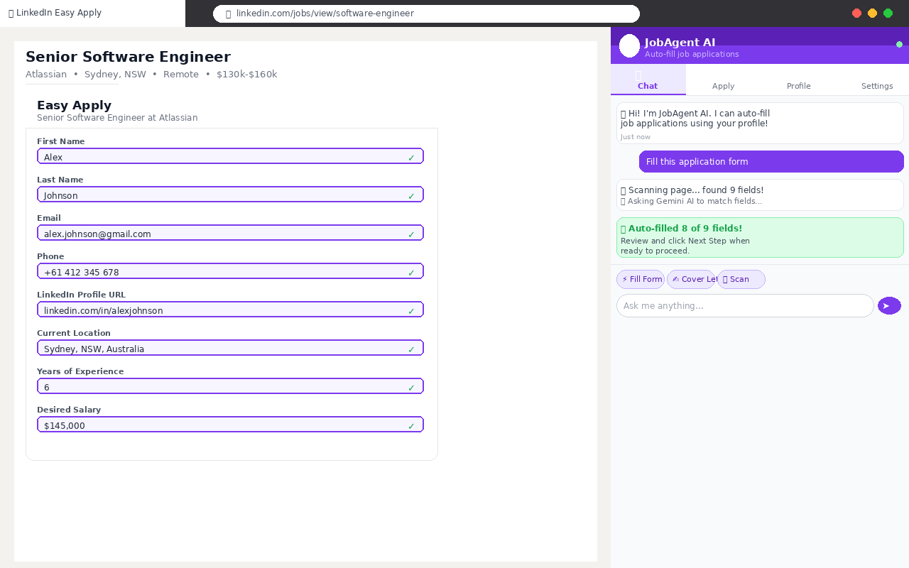
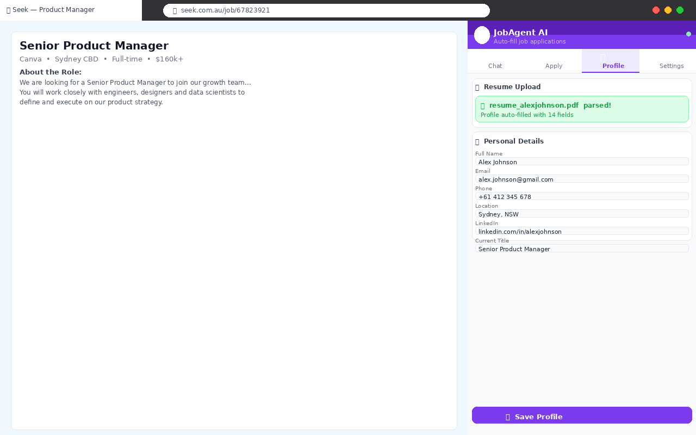
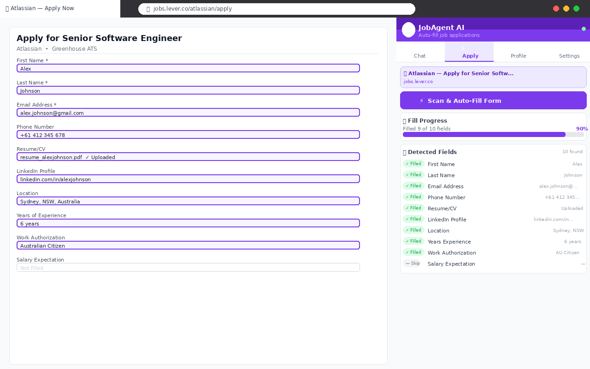
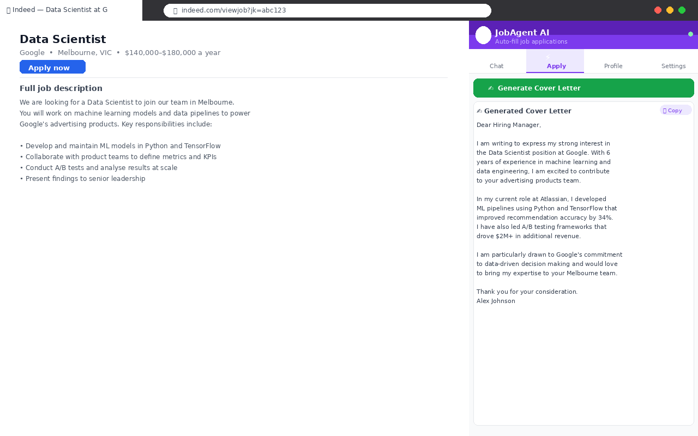
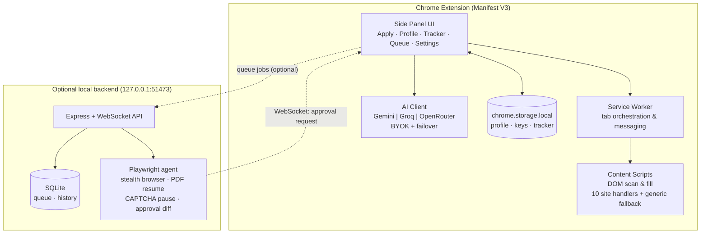

# JobAgent AI — Auto Apply 🚀

> **A free, local-first AI copilot that fills job applications for you — across LinkedIn, Seek, Indeed, Glassdoor, Workday, Greenhouse, Lever, Ashby and SmartRecruiters.**

**Status:** ✅ Live on the Chrome Web Store &nbsp;·&nbsp; Version 3.1.0 &nbsp;·&nbsp; 30+ organic users

[**→ Install from the Chrome Web Store**](https://chromewebstore.google.com/detail/jobagent-ai-%E2%80%94-auto-apply/aaakmoeekjeibjgmkfkhhkhnghpbblom?authuser=0&hl=en) &nbsp;|&nbsp; [Privacy Policy](https://sone31.github.io/jobagent-ai/privacy-policy.html)

---

## Screenshots

<!-- Copy your store screenshots into an /assets folder in this repo and keep these paths -->
| Auto-fill in action | Match score overlay |
|---|---|
|  |  |

| Application tracker | Settings & BYOK |
|---|---|
|  |  |

---

## Why I built this

Job hunting means re-typing the **same 40 fields** into a different applicant tracking system (ATS) for every single application — LinkedIn one day, Seek the next, then Workday, Greenhouse, Lever…

AI "auto-apply agents" already exist, but they charge **$19–$99/month**, run your personal data in their cloud, and submit applications on your behalf with zero transparency.

So I built the alternative I wanted to use:

- 🆓 **Free** — no subscription, no per-application fee
- 🔒 **Local-first** — your profile, resumes and application history live in your browser, never on a server I operate
- 🔑 **BYOK** — you power the AI with your **own** API key (Gemini, Groq or OpenRouter — free tiers included)
- 👀 **You stay in control** — everything is reviewable before anything is submitted

---

## Features

| Feature | What it does |
|---|---|
| ⚡ **One-click auto-fill** | Scans every field on the application form and fills it from your saved profile using an LLM — works on virtually any job site, with tuned handlers for 10 major platforms |
| 🧭 **Multi-step form support** | Detects "Next / Continue" flows, and when a form has no fields yet, clicks *Apply* for you and re-scans |
| 📄 **Resume upload & parsing** | Upload a resume (PDF/TXT) and the AI extracts your profile automatically — no manual typing |
| ✉️ **Tailored cover letters** | Generates a cover letter from the *actual job description on the page* and fills it into the form |
| 🎯 **Match score** | AI compares the job description against your profile and returns a match % plus missing keywords |
| 📊 **Application tracker** | Every application is auto-logged with status tracking and CSV export |
| 🤖 **Optional hands-off queue** | A local Node.js + Playwright backend applies to queued jobs in a real browser, generates a tailored PDF resume, and pauses for **your approval** (diff view) before final submit |
| 🔐 **BYOK multi-LLM** | Google Gemini, Groq and OpenRouter with automatic provider failover — all AI calls go directly from your browser to the provider using your own key |

---

## How it works (the 60-second version)

```
1. You save your profile once (or upload a resume → AI parses it)
2. You open any job application page and click "Scan & Auto-Fill"
3. The content script reads the page DOM and inventories every form field
4. An AI layer maps each field label → your profile data (name, email,
   work history, skills, education, open-ended questions…)
5. Fields are filled with native DOM events so frameworks (React/Workday etc.) accept them
6. Cover letter generated if the form asks for one · match % calculated
7. Application is logged in your local tracker — ready for the next job
```

## Architecture



---

## Tech stack

| Layer | Technology |
|---|---|
| Extension | JavaScript (vanilla), Chrome **Manifest V3**, Side Panel API, Content Scripts, Service Worker |
| Storage | `chrome.storage.local` — zero developer servers |
| AI | Google **Gemini** (default: `gemini-3.6-flash`), **Groq** (Llama 4, Qwen3, Kimi K2, DeepSeek R1…), **OpenRouter** (including free-tier models) — unified client with automatic failover |
| Backend (optional) | **Node.js**, **Express**, **WebSocket (ws)**, **SQLite** (`better-sqlite3`), **Playwright** + `playwright-extra` + stealth plugin |
| PDF generation | Markdown → HTML (`marked`) → PDF via headless browser |
| Publishing | Chrome Web Store (store listing, privacy policy, screenshots, promo assets, review compliance) |

### Supported job platforms

LinkedIn (incl. Easy Apply) · Indeed (incl. AU) · Seek (AU/NZ) · Glassdoor · Workday · Greenhouse · Lever · Ashby · SmartRecruiters · **+ generic fallback for any other site**

---

## Repo structure

```
extension/          # Chrome Extension source (Manifest V3) — this is what ships to the Web Store
backend/            # Optional local Node.js + Playwright automation backend
assets/             # Screenshots & promo banner
privacy-policy.html # Published privacy policy
```

---

## Run it yourself (development)

**Extension (load unpacked):**

```bash
git clone https://github.com/sone31/jobagent-ai.git
cd jobagent-ai
# Chrome → chrome://extensions → enable Developer mode → "Load unpacked"
# → select the "extension" folder inside this repo
```

Then open the side panel, go to **Settings**, paste your free
[Gemini API key](https://aistudio.google.com/app/apikey) (or a Groq / OpenRouter key), and save your profile.

**Optional automation backend:**

```bash
cd backend
npm install
npx playwright install chromium
node server.js   # → http://127.0.0.1:51473
```

The extension's **Queue** tab will detect the backend automatically and you can send jobs to hands-off apply. The backend runs in a real (non-headless) browser so you can solve CAPTCHAs, and asks for approval before clicking final submit.

---

## Privacy by design

- ✅ Profile, API keys and application history live **only** in `chrome.storage.local` on your machine
- ✅ AI calls go **directly** from your browser to your chosen provider with **your** key
- ✅ No analytics, no tracking, no developer servers, no accounts
- ✅ Published privacy policy declaring no data collection
- ✅ In hands-off mode, nothing is submitted without your explicit approval in the diff view

---

## The build story (v1.0 → v3.1)

This project was built solo, end-to-end: product spec, UX, engineering, testing, store assets, policy compliance and release management.

**Lessons shipped along the way:**

1. **Chrome Web Store rejection → policy mastery.** My first store listing was rejected for *keyword spam* (I listed every supported job platform in a giant keyword block). I rewrote the description as user-focused copy, resubmitted, and it was approved. Lesson: store review is a real, testable process — treat policy like code.
2. **Manifest compliance.** `*://wd*.myworkday.com/*` is an invalid match pattern (Chrome only allows wildcards at the start of a hostname). Fixed with validated `*://*.myworkday.com/*` patterns and a validation script that checks every pattern before shipping.
3. **Model deprecation happens overnight.** `gemini-2.0-flash` was retired mid-project, so I migrated defaults to `gemini-3.6-flash` and built a **multi-provider failover client** so a single model retirement can never break the product again.
4. **Cutting features is a feature.** v3.1 was a clean rewrite that removed the chat panel and secondary buttons. One primary action — *Scan & Auto-Fill* — tested better than seven half-working ones.

**Version history**

| Version | Highlights |
|---|---|
| 1.0 | Initial Chrome Web Store release — core auto-fill + Gemini |
| 2.x | Multi-API failover (Gemini/Groq/OpenRouter), ATS-specific handlers, match-score overlay, cover letters, tracker with CSV export |
| 3.0 | Local Node.js + Playwright automation backend with SQLite queue and tailored PDF resumes |
| 3.1 | Clean rewrite: single primary action, robust field detection, multi-step form handling, approval-first UX |

---

## How AI was used to build this

Built with an **AI-assisted, spec-driven development workflow**: I wrote the product specs and architecture, directed agentic coding tooling to implement modules, then personally reviewed, debugged and tested every release on a MacBook Air M3 via `chrome://extensions` load-unpacked cycles, browser DevTools, and real job applications. AI accelerated the build; product decisions, QA and shipping were mine.

---

## Roadmap

- [ ] More ATS handlers (Taleo, iCIMS, Workable, BambooHR)
- [ ] Answer memory — learn from corrections and reuse them
- [ ] Response tracking (interviews / rejections) in the tracker
- [ ] Firefox port
- [ ] Smarter match scoring with keyword gap suggestions per role

---

## Disclaimer

JobAgent AI assists you in filling out applications. **You are responsible** for reviewing every application and for complying with the terms of service of the job platforms you use. Always keep the approval step enabled for automated submissions.

---

## License

MIT — see [LICENSE](LICENSE).

---

**Built by Harshit Sone** · [Chrome Web Store](https://chromewebstore.google.com/detail/jobagent-ai-%E2%80%94-auto-apply/aaakmoeekjeibjgmkfkhhkhnghpbblom?authuser=0&hl=en) · [LinkedIn](https://www.linkedin.com/in/your-handle) · [Portfolio](https://your-site.com)
